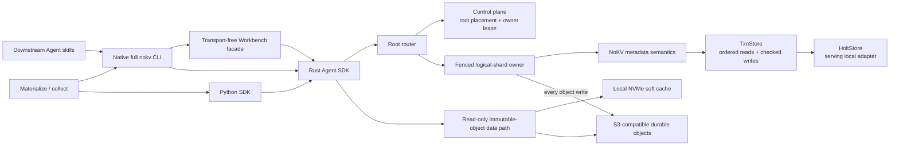
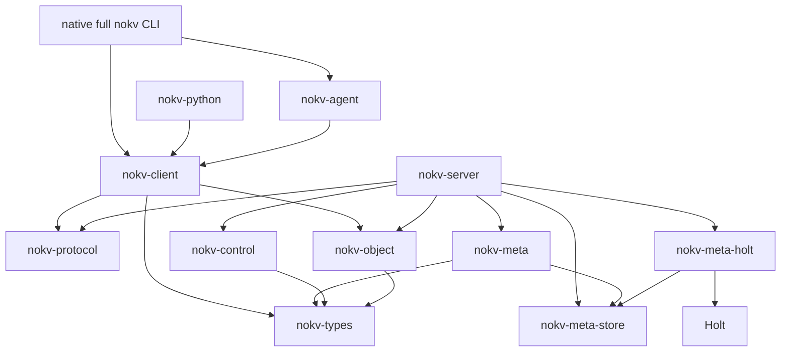
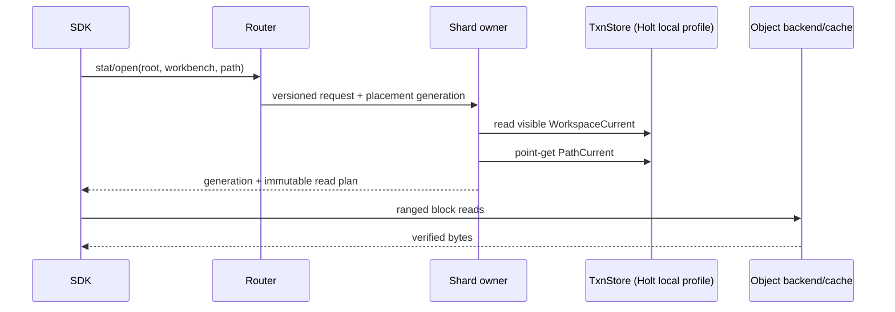
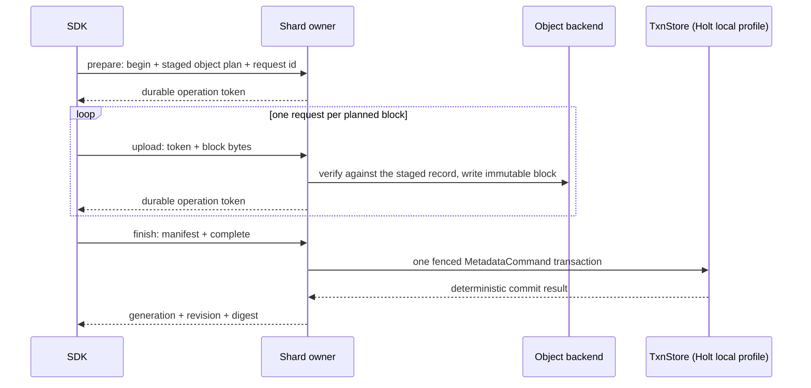
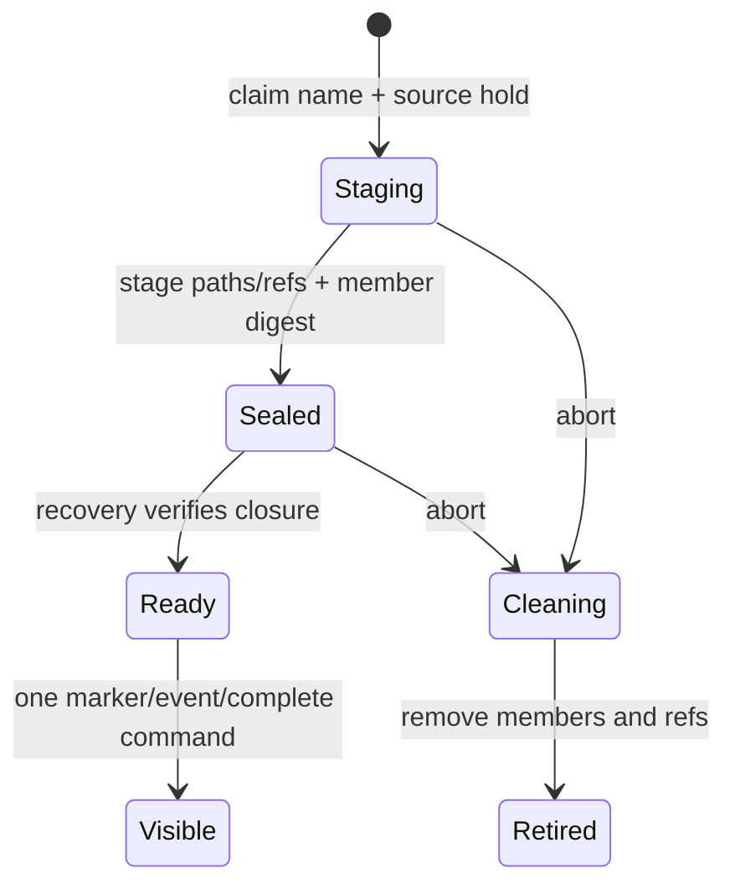

<!--
Copyright 2024-2026 The NoKV Authors.
SPDX-License-Identifier: Apache-2.0
-->

# Architecture

Status: normative workspace architecture.

## System Shape



The metadata and object paths are separate. Small control and namespace records
go through the shard owner. Clients read immutable blocks directly through the
object boundary with prefix-scoped read-only credentials. Every object write is
the owner's: a client carries each planned block to the owner in one request,
and the owner writes it with the only credentials that can.

FUSE, POSIX, CSI, and fsspec are not architecture layers.

## Package Direction



Arrows point from a consumer to its dependency. The
[code contract](./development/code_contract.md) is normative.

Key constraints:

- types and protocol are storage-neutral;
- metadata owns durable semantics, logical keyspaces, and record codecs;
- the Holt adapter owns the physical tree mapping and local durability;
- control owns root placement and owner fencing, not path semantics;
- object owns provider I/O, not reachability;
- client uses protocol/routing and never imports meta/server;
- Agent adapters shape tools over SDK traits and remain transport-free;
- the native full CLI is the primary integration surface;
- the Python SDK is the secondary embedded surface.

## Identity And Namespace

```text
RootPlacement(root_id)                    control-plane truth
RootFence(root_id)                        installed shard-local fence

WorkspaceCurrent(root_id, workbench_id)
  -> incarnation, revision, lifecycle

WorkspaceIncarnationClaim(root_id, incarnation)
  -> stable workbench_id; permanent and never reused

PathCurrent(root_id, incarnation, path)
  -> generation, immutable revision, body/manifest digests, size,
     dependency bounds, content type, typed projection
```

The control plane also binds each root to one object namespace and one
`AgentId`. Without RPC TLS, the native CLI checks the `AgentId` binding to
catch misconfigured routing; it is not authorization. Over RPC TLS, tenants own
roots, principals hold roles on roots, and the owner authorizes every request
instead, as [Read Path](#read-path) describes
([code contract](development/code_contract.md#tenant-identity-and-access-control)).

`PathCurrent` is the only namespace truth. Workbench names are separated from
path keys by a never-reused incarnation. This prevents a failed restore or
retired Workbench's rows from appearing under a later claim.

Paths are exact case-sensitive UTF-8. The physical codec adds one to each UTF-8
byte, separates components with NUL, and ends an exact key with marker `0x01`.
This reserves both markers, places a child's delimiter rollup before its exact
artifact and both before longer siblings, and prevents an exact key from being
a strict prefix of another valid path key. The same normalizer/codec owns
storage keys, request identities, index identities, and restore member ids.
System format version 13 retains and gates this layout.

Directories are implicit. The Workbench root and five standard sections are
virtual. A file stat is a point read; an implicit-directory stat is a prefix
existence check.

See [Metadata Schema](./metadata-schema.md) for byte-level and state-machine
rules.

## Read Path



A valid cached Workbench marker can avoid its routing/lookup work, but the
client still uses generation/version validation. The authoritative artifact
lookup is one exact schema key and does not follow the revision-lifetime row.
The current portable read path first captures owner, root-fence, and commit
clock state. Each dependent marker or path point read then batches those three
guards with its data key in one `TxnStore::read` call. This costs eleven point
reads for an uncached live exact get, but it does not rely on a backend-specific
snapshot session. A later declarative batch API can remove the repeated guards
without weakening owner fencing.

A direct-child list replaces the path lookup with one ordered prefix-scan path.
Its common-prefix rollups become implicit-prefix page items. A recursive list
uses the same prefix without delimiter rollup. Each physical
page batches its owner, root-fence, and commit-clock guards with a bounded store
scan. One protocol page may use multiple scans of at most 255 logical items
each when its requested limit is larger. The metadata listing may merge an
exact-prefix point read only after descendant EOF, while the Workbench adapter
exposes only direct children and drops that self row.
There is no per-entry metadata fanout. The returned cursor is bound to the
workbench scope, read view, continuation fence, and child anchor. Snapshot
continuations retain one exact root read version. Live continuations may move
to a newer root read version only while the target workspace incarnation and
revision remain unchanged; target drift fails closed, and an initial bounded
collection may restart in full but never merges workspace revisions. This
contract is gated by operation schema `nokv.workspace.rpc.v15`; v15 adds the
TLS and authentication answers of the handshake described below. V14 added the
`PublishInlineArtifact` request, which admits and completes a publication whose
body travels with it and is stored inline, and the inline body of a ranged
`GetPath` result. V13 added the fused `PrepareArtifactPublish` and
`FinishArtifactPublish` requests. V12 added
metadata-only append ledger inspection and exact-token owner cleanup retry.
V11 added durable logical append parents,
predecessor-fenced publication attempts, and metadata-only append status. The
initial exact append-intent binding was introduced by v10. v7 added the
exact read-version fence used by path point reads, v8 added the required typed
`Prefix`/`Exact` catalog path match so an artifact cannot inherit fields from
same-name descendants, and v9 added an explicit query profile plus tagged query
rows and authoritative search, aggregate, and catalog totals/facets. V3 first
added the provider-neutral object namespace identity to every root route.

Each TCP connection starts with the fixed-width, schema-neutral transport
handshake v1. The client offers one exact operation schema, and the server
accepts only `nokv.workspace.rpc.v15`; the handshake version remains stable when
the operation schema changes. For upgrade diagnostics, the server recognizes
only operation-first envelopes from the public v2 client and the post-tag v3
client. It parses a bounded route/request header, ignores the operation, emits
one schema-readable failure, and closes without dispatch. The v2 client gets
its exact v2 failure envelope; the v3 client gets a v15 failure envelope so its
decoder reports the v15/v3 schema mismatch. Unknown legacy schemas, malformed
envelopes, and malformed handshakes fail closed. This is a read-only rejection
path, not a legacy response decoder or operation fallback.

An owner configured with a certificate serves TLS 1.3 only: no resumption, no
early data, and no plaintext fallback. The TLS handshake and the protocol
handshake inside it share one absolute deadline, enforced below the TLS layer
so a peer that trickles bytes cannot extend it. The owner requires a client
certificate and checks at the TLS layer only that the client holds its key.
After TLS, the SHA-256 of the certificate must be a current credential of the
tenant bound to every root the owner serves; the credential names the
connection's principal. A current-schema hello from any other certificate gets
`Unauthenticated`, a plaintext current-schema hello gets `TlsRequired`, and an
owner without TLS answers a TLS client hello with a plaintext `TlsUnavailable`
frame that the client reads before parsing TLS records. Clients fix the
trusted owner name and roots in their configuration rather than taking them
from routes, and a transport reuses a pooled connection only under the
identity it was opened with.

Every request on a TLS connection is authorized before route lookup. The
principal needs a role on the request's root that includes the operation's
role: reader for reads, writer for writes, and operator for reconciling a
quarantined publication. A tenant-wide role covers every root of the tenant,
and a root role covers its root. A refusal is `PermissionDenied` and carries no
route hint, generation, or commit version. The owner keeps a copy of its
tenant's records and rereads them every second, and every handshake and every
request is checked against the latest copy. A credential or role that is
added or revoked therefore takes effect within a second, plus a request
already in flight; a revoked credential also closes its open connections
after one `Unauthenticated` answer. If the copy cannot be refreshed for 10
seconds, the owner refuses requests with a retryable `Unauthenticated` until a
refresh succeeds. The copy is refreshed on a thread of its own, and every
control-plane call is bounded by the owner's lease timing, so a slow control
plane delays no connection. A root bound to a tenant is served only over TLS:
an owner started without TLS refuses such a root instead of serving it to
anyone. Over TLS the CLI does not check the plaintext `AgentId`
binding, so many principals can work on one root and one principal on many
roots.

Every durable operation records the principal that began it, and only that
principal continues, aborts, or completes it. A principal with the operator
role on the root continues any operation, and the owner's own recovery and
cleanup continue everything. A request that continues another principal's
operation is refused with `PermissionDenied` and changes nothing. Commit and
restore operation ids derive from their content, so another principal
beginning the same commit or restore observes the first one: while it is in
flight the request is refused with a retryable `Conflict`, and once it is
terminal the request replays its outcome. Publish, append, snapshot, and
Generic index operation ids are caller-chosen and sealed with the initiator,
so another principal presenting the same id is refused as a different intent.
A request id replays only for the principal that claimed it. Operation
status and change events name the initiator.

Secondary-index queries run at one read version and filter every result by the
matching visible incarnation. `ArtifactV1` remains the default Workbench query
contract. `GenericNamespaceV1` carries a bounded, normalized, display-only
presentation root and materializes Workbench, section, implicit-directory, and
artifact rows at that same read version. Its transient `path` scalar is the full
presentation path, while row identity stays the canonical Workbench and relative
path. An exact artifact wins over a same-name virtual directory without hiding
descendants. Its cursor binds the profile, presentation root, storage root, read
version, and query. Presentation paths are never persisted as metadata or used
as storage authority.
The generic catalog exposes the seven legacy built-ins plus declared durable
custom indexes. Custom-index registration builds an immutable, paged generation
behind one current-pointer CAS; rows retain ordered duplicate values and exact
directory or artifact-revision binding. Commit, snapshot, restore, retirement,
and reference GC carry the same sealed generation closure, so a dirty snapshot
can be restored without an intervening commit and an old generation cannot be
reused after reclamation. Object bodies are read only when the selected tool
actually requires them.

## Publish Path



The command validates schema, local root fence, owner epoch, request id,
workspace/path generations, and revision reference state before applying any
mutation. It atomically publishes:

- the revision and block manifest;
- the new path and workspace revision;
- strong-reference changes;
- secondary indexes;
- one typed event;
- GC candidacy for a replaced revision;
- the deterministic replay result.

A plan whose staged objects and manifest rows each fit one batch publishes with
two metadata requests around its uploads, each one write session and one
durable acknowledgement: Prepare before the first block and Finish after the
last. Each request runs the stepwise Begin, StageObjects, StageManifest, and
Complete steps under request identities derived from its own, so replay and
token rules are unchanged; a larger plan, or a resumed one, uses the stepwise
requests. Every block travels in its own UploadArtifactObject request of at
most one block size: the owner checks its length and digest against the staged
record in one short write session, writes it to the provider with no metadata
lock held, and records the upload in a second session, so other requests of
the shard never wait for a provider round trip, a retried upload replays, and
a resumed publication continues from the owner's upload cursor without sending
a recorded block again.

Failed uploads never become visible. Response loss after commit returns the
same result on retry. Generic random writes are absent; append is immutable
segment publication plus stream-head CAS.

Commit replay resolves its deterministic build-operation identity before any
live workspace lookup. A terminal retry authenticates the complete stored
request and commit-owned run-manifest binding, then verifies the corresponding
durable publish-operation result. Consequently a later replacement head cannot
change the result of retrying an older exact commit.

The durable request also stores a domain-separated digest of every caller-known
run-manifest projection input except the owner-supplied commit time. Recovery
checks that digest before rebuilding or publishing a manifest, including while
the commit is still Running and has no staged-manifest binding.

## Revision Ownership

```text
nokv/artifacts/{logical_shard_id}/{root_id}/{artifact_revision_id}/blocks/{object_index}
```

Revision ids never name a physical owner. A process owner may change while
logical-shard/root/revision identity stays stable.

Every current path and durable commit has an exact `RevisionRef`. A revision
that reuses older blocks has a sealed dependency reference to each distinct
owner revision. The child revision stores a strong-reference count and epoch:

```text
reference add/remove
  -> mutate RevisionRef
  -> update count
  -> increment epoch
  -> if count == 0, create candidate(epoch, last_zero_version)
```

GC claims only the current zero-count epoch and atomically moves the revision
from `Available` to `Deleting`. New references require `Available`, closing the
restore/commit-versus-delete race.

## Snapshot And Commit Reads

NoKV's logical history and hold records support two different products:

- a leased snapshot creates a `HistoryHold(read_version)`;
- a durable commit scans under a temporary `HistoryHold`, writes an ordered
  tree manifest, adds exact commit revision refs, verifies closure seals, then
  releases the history hold.

The snapshot reaper and renew operation race through one durable lifecycle CAS.
Once `ReapClaimed` wins, the history hold is gone and renewal fails.

`TxnStore` supplies a consistent snapshot for each read batch. `MetaShard`
reconstructs historical state across bounded batches and restarts if the
domain commit clock changes. NoKV does not expose a retained Holt view as a
snapshot or commit contract.

Commits do not pin global history. Tags are CAS-protected names for commits.
Commit retirement is explicit and checks all heads, tags, leases, lineage
children, and restore/fork consumers.

## Restore

Restore uses an operation-owned fresh Workbench incarnation:



Staged paths have strong references but no visible marker. Root-wide query and
watch surfaces therefore cannot leak them. The final command verifies the exact
incarnation and member seal, publishes it, completes the operation, emits one
event, and releases the source hold.

Restore copies O(entries) metadata and zero object bytes inside one root/shard.
NoKV deliberately avoids a lazy overlay that would tax every later read/list.

## Sharding And Ownership

The control plane persists placement before a root's first write:

```text
RootId -> immutable LogicalShardId
LogicalShardId -> current physical owner, lease, epoch
```

The owner installs or validates `RootFence` in its metadata shard and checks
the lease epoch in the same physical transaction as each metadata commit.
Placement is never inferred from a path or modulo the number of owners.

A hot root's logical shard may be assigned to a dedicated physical process.
That is owner movement, not a change to logical shard or object keys.

One root is not split across logical shards. Cross-shard operations fail before
partial work.

## Recovery And Durability

Each production profile names its acknowledgement boundary:

```text
local
  ACK after shard-local Holt WAL boundary

durable distributed
  ACK after the configured shared logical-log boundary
```

The two modes have separate SLOs and benchmark rows. Recovery uses checkpoint
images plus the logical command log. Owner epoch prevents an old process from
committing or deleting objects after failover.

Current implementation status: the local Holt WAL boundary and the
object-backed shared-log boundary are executable. Every acknowledged metadata
mutation first commits to the shard-local hash-chained recovery outbox. The
shared boundary then persists an exact upload intent in Control, creates the
receipt-addressed immutable chunks and manifest, and atomically publishes the
new log frontier before returning. Control bounds both the logical chain and
the canonical encoded record so an upload is rejected before its first object
write if its pending or finalized etcd record cannot fit the admitted request
budget.

`Reopen` restarts the same exclusive Holt namespace. `RecoverLog` creates or
resumes a local namespace from strict shared-log receipts. Both paths validate
canonical receipts and prove the Control frontier is an exact prefix before
owner acquisition, then renew and repeat the proof after acquisition before
installing the owner fence. Complete pending uploads are replayed exactly;
incomplete uploads retain their intent until every receipt-derived cleanup key
is confirmed deleted or absent, after which an owner-fenced CAS may abort the
intent. Ambiguous cleanup remains fail-closed. Crashes after pending replay or
owner activation are resumable because a verified local-ahead prefix is not
mistaken for divergence. A completed owner gets the next epoch; an unfinished
`Recovering` owner rebinds the same epoch, so repeated crashes cannot create an
epoch gap.

Cold checkpoint installation is not yet admitted by the default product build:
the pinned published Holt dependency does not expose the bounded borrowed
checkpoint API. A Control checkpoint frontier therefore remains fail-closed in
`RecoverLog`. Log truncation/compaction, copied-directory identity, cross-host
checkpoint failover, and fsck also remain outside this qualification.

Because no checkpoint publisher exists yet, the shared log chain only grows:
every acknowledged mutation appends one segment reference to the Control
logical-shard record, and Control bounds that record (`MAX_LOGICAL_SHARD_RECORD_BYTES`)
and the chain length (`MAX_RECOVERY_LOG_SEGMENTS`). A shard that reaches either
bound loses its owner fence and stops serving; on the current record size that
happens after roughly a hundred acknowledged publications. Shared publication
is therefore an opt-in, not the resting state.

`nokv serve --recovery-publication` selects the recovery authority:

- `local-only` (**default**) keeps the exclusive Holt WAL as the only recovery
  authority, publishes no segments, leaves any earlier shared frontier frozen,
  and still proves owner liveness before every acknowledgement. Control is used
  for routing and the owner session only: a local control directory, whose
  session is a file lock released with the owner process, or etcd, whose
  session is a lease. A `local-only` shard has no
  shared-log successor path: losing its Holt directory loses the metadata,
  exactly as with the `local` mode above.
- `shared` is the object-first boundary described above. It is implied by
  `--metadata-recover-log`, which can only resume from a shared frontier, and
  it cannot be combined with `local-only` on that open mode. Do not select it
  for a shard that will accept more than a bounded burst of writes until
  checkpoint compaction lands.

Durable ledgers, not object listing, recover:

- staged/multipart uploads;
- commit construction;
- restore staging and cleanup;
- GC claims and ambiguous deletes.

The required fsck recomputes reference counts and closure seals from metadata;
source or design text alone is not fsck evidence.

## Architecture Acceptance

The architecture is accepted as one system, not as independent storage
experiments. The required evidence covers:

1. namespace point reads, delimiter scans, conflict handling, and command
   amplification across the declared workload matrix;
2. revision-owned publication, visibility, lifecycle, references, GC, and
   recovery;
3. protocol, server, native CLI, Python and Rust SDKs,
   control routing, and lifecycle workers on
   the same schema and identity model;
4. owner failover, checkpoint/log recovery, ambiguous provider outcomes, and
   live Workbench workflows;
5. the complete [acceptance plan](./development/workspace-acceptance.md),
   with each applicable gate reported as `PASS`, `FAIL`, or `NOT QUALIFIED`.
